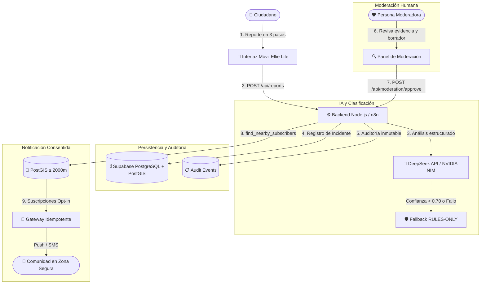

# Ellie Life Enterprise — Seguridad y Evacuación (Piura)

> **Solución comunitaria con Inteligencia Artificial responsable ante el Fenómeno El Niño**  
> Hackathon UPN 2026 • Categoría: Comunidades preparadas, resilientes y sostenibles.

- **Equipo:** GRUPO ELLIE (Equipo 5)
- **Integrantes:**
  - FABRIZZIO PAOLO PELAEZ BAUTISTA
  - OSIRIS DE LOS ANGELES MEDINA ACEVEDO
  - LUIS ADRIANO CABALLERO OLIVERA
  - CAROLINE SOFIA SOSA LEDESMA
- **Enlace a demo:** https://hack-upn-2026-fabrizzio-pelaez.fabrizziopelaez91.workers.dev/
- **Pull Request Oficial Hackathon:** https://github.com/MyBotsLatam/Hackathon-UPN-IA/pull/6

---

## 📌 Repositorios Oficiales del Proyecto

- **Aplicación Principal (Frontend + Backend + n8n):**  
  [https://github.com/Pelaez12/HACK-UPN-2026-FABRIZZIO_PELAEZ.git](https://github.com/Pelaez12/HACK-UPN-2026-FABRIZZIO_PELAEZ.git)
- **Base de Datos Supabase (PostGIS + RLS + Migraciones):**  
  [https://github.com/Pelaez12/BASE-DE-DAOTS-ELLIE.git](https://github.com/Pelaez12/BASE-DE-DAOTS-ELLIE.git)

---

## 🌊 Contexto y Desafío: Piura y el Fenómeno El Niño

El departamento de Piura enfrenta periódicamente lluvias intensas, crecidas extraordinarias de los ríos Piura y Chira, descargas de alivio en la represa de Poechos y aislamiento de sectores en distritos como Catacaos, Castilla, Tambogrande, Sullana y Paita.

**Ellie Life Enterprise** transforma la respuesta comunitaria mediante una plataforma móvil preventiva que combina:
1. **Croquis de evacuación simplificado** con zonificación y rutas seguras accesibles sin conexión.
2. **Reporte ciudadano estructurado** en 3 pasos con geolocalización aproximada (±500m) y derecho al olvido.
3. **Agente IA asistido (DeepSeek)** con umbral estricto de confianza (≥ 0.70) y fallback determinista *RULES-ONLY*.
4. **Control Humano Obligatorio (Human-in-the-Loop):** La IA jamás emite alertas automáticas; asiste a moderadores para preparar borradores.
5. **Notificaciones geográficas por proximidad (PostGIS):** Radio máximo de 2.000 metros hacia personas con consentimiento explícito.

---

## 🏛️ Arquitectura del Sistema



---

## ✨ Características Principales

### 1. Interfaz Móvil y Experiencia de Usuario (Stitch Inspired)
- **7 Secciones de navegación:** Inicio, Croquis, Reportar incidente, Ellie Asistente, Notificaciones, Contactos, y Perfil/Accesibilidad.
- **Identidad visual Ellie Life:**
  - Morado principal: `#4B36F2` | Lavanda: `#8E82FF` | Fondo claro: `#F5F3FF` | Tinta: `#171528`
  - Semáforo de seguridad: Verde seguro `#258A5A` | Ámbar `#B97918` | Rojo peligro `#B04440`
- **Modo sin conexión visual:** Caché de mapa vectorial y croquis mediante Service Worker (`/sw.js`).
- **Nivel de preparación familiar:** Checklist interactivo ("3 de 5 pasos completados").

### 2. Reporte de Incidentes en 3 Pasos
- **Paso 1:** Selección de evento con apoyo visual (🌊 Inundación, 🏞️ Desborde de río, 🚧 Vía bloqueada, 🏠 Vivienda afectada, 🆘 Necesito ayuda, ❓ Otro).
- **Paso 2:** Descripción, foto/audio opcionales, distrito/sector, personas afectadas, estado del reportante y toggle de ubicación aproximada.
- **Paso 3:** Resumen, consentimiento de procesamiento y aviso destacado:  
  *“Este reporte será revisado y no genera una alerta automática.”*
- Asignación de código único (ej: `REP-4821`) y estados rastreables: *Borrador, Enviado, En revisión humana, Requiere más info, Verificado, Descartado*.

### 3. Croquis Seguro de Evacuación
- Visor de plano de zonificación urbana detallada de Piura.
- Zonas de reunión seguras verificadas (Explanada UNP, Coliseo Gerónimo Seminario y Jaime) y puntos en observación (Puente Sánchez Cerro, Malecón Eguiguren).
- Geolocalización voluntaria aproximada (±500 metros), sin rastreo continuo ni exposición de coordenadas exactas.

### 4. Ellie Asistente — IA Conversacional Responsable
- Motor DeepSeek integrado exclusivamente desde backend (nunca expone claves en el navegador).
- Validación de esquema estricto: `type`, `sector`, `confidence`, `missing`, `abstained`, `rationale`.
- **Regla de oro de abstención:** Si `confidence < 0.70`, el agente se abstiene obligatoriamente (`abstained = true`).
- En caso de fallo o timeout, activa el mensaje transparente:  
  *“IA no disponible. Se ejecutó el fallback RULES-ONLY. Revisa antes de confirmar.”*
- **Guardrails de seguridad:** La IA nunca declara emergencias oficiales, no envía alertas directamente ni comparte ubicación de personas.

### 5. Directorio Oficial Piura (21 Contactos de Emergencia)
- Lista configurable con números de primera respuesta (PNP 105, Bomberos 116, SAMU 106, INDECI 115, Comisaría Piura, Serenazgo Piura, Hospital Santa Rosa, Hospital Cayetano Heredia, etc.).
- Marcadas como `verified: false` hasta su confirmación por administradores.

### 6. Suite Completa de Accesibilidad
- **Tamaños de fuente:** Normal, Grande (115%), Muy Grande (130%).
- **Modo Alto Contraste:** Cumplimiento WCAG AAA.
- **Modo Oscuro** y texto en negrita reforzada.
- **Lectura en voz alta (Text-to-Speech):** Botón *“Escuchar pantalla”* con Web Speech API en español.
- **Respuesta háptica:** Vibración en botones táctiles de mínimo 44×44px.
- **Navegación accesible:** Foco visible por teclado y compatibilidad con `prefers-reduced-motion`.

---

## 🔒 Privacidad y Política de Consentimiento

Conforme a `supabase/consent-policy-piura.md`:
- **Consentimientos 100% separados (Sin casillas preseleccionadas):**
  1. Procesamiento del reporte comunitario.
  2. Uso de ubicación aproximada.
  3. Notificaciones push preventivas.
  4. Mensajería SMS de emergencia.
  5. Asistencia y análisis con IA.
- **Derecho al olvido:** Botón directo para que el usuario revoque permisos y elimine sus reportes y datos personales.

---

## 🗄️ Esquema Supabase y Row Level Security (RLS)

Ubicado en `supabase/ellie_piura_schema.sql`:
- **Extensiones:** `postgis`, `pgcrypto`.
- **Tablas:** `profiles`, `consent_records`, `incidents`, `authorities`, `subscriptions`, `alerts`, `alert_deliveries`, `audit_events`.
- **Roles:** `ciudadano`, `moderador`, `autoridad`, `administrador`.
- **Políticas RLS:** Control estricto de acceso. Los ciudadanos solo administran sus propios reportes y suscripciones; los moderadores revisan y aprueban alertas; las autoridades consultan incidencias verificadas; el administrador gestiona retención y roles.

---

## 🤖 Workflows de Automatización n8n

Ubicados en `n8n/ellie_piura_workflows.json`:
1. **Workflow A (`POST /ellie/piura/report`):**
   - Entrada de webhook ciudadano.
   - Validación de descripción y consentimiento.
   - Clasificación de nivel de peligro.
   - Consulta opcional a DeepSeek con fallback RULES-ONLY.
   - Inserción en Supabase y auditoría.
   - Respuesta HTTP 202 con código de incidente y aviso de no alerta automática.
2. **Workflow B (`POST /ellie/piura/moderation/approve`):**
   - Confirmación de decisión humana del moderador.
   - Búsqueda geoespacial PostGIS (`find_nearby_subscribers` ≤ 2000m).
   - Bifurcación Push / SMS con control de idempotencia.
   - Despacho y registro de entrega en `alert_deliveries`.

---

## 🧪 Suite de 20 Pruebas Obligatorias

Ejecuta la suite con:

```bash
npm test
```

### Resultados de la batería de pruebas:
```
================================================================
EJECUTANDO SUITE DE 20 PRUEBAS OBLIGATORIAS — ELLIE LIFE PIURA
================================================================
✅ [TEST 01] PASS: Reporte válido sin ubicación
✅ [TEST 02] PASS: Reporte válido con ubicación autorizada
✅ [TEST 03] PASS: Reporte sin descripción (debe ser rechazado)
✅ [TEST 04] PASS: Usuario sin consentimiento push no recibe notificación
✅ [TEST 05] PASS: Usuario sin consentimiento SMS no recibe mensaje de texto
✅ [TEST 06] PASS: Filtro por radio de 500 metros
✅ [TEST 07] PASS: Radio de 2.000 metros y límite máximo
✅ [TEST 08] PASS: Usuario fuera del radio no entra en la búsqueda
✅ [TEST 09] PASS: IA disponible devuelve esquema estructurado
✅ [TEST 10] PASS: IA no disponible activa fallback RULES-ONLY seguro
✅ [TEST 11] PASS: Respuesta IA con JSON corrupto deriva a RULES-ONLY
✅ [TEST 12] PASS: Abstención obligatoria cuando confianza es menor a 0.70
✅ [TEST 13] PASS: Aprobación humana válida por moderador autorizado
✅ [TEST 14] PASS: Aprobación sin moderator_id es rechazada
✅ [TEST 15] PASS: Alerta sin confirmación de consentimiento de audiencia es rechazada
✅ [TEST 16] PASS: Idempotencia previene envíos duplicados de una alerta
✅ [TEST 17] PASS: Alerta expira dentro del límite de 2 horas
✅ [TEST 18] PASS: Revocación de consentimiento actualiza estado y desactiva canales
✅ [TEST 19] PASS: Eliminación segura de reportes del usuario
✅ [TEST 20] PASS: Auditoría registra actor_id, event_type y metadata
================================================================
RESUMEN: 20 / 20 PRUEBAS COMPLETADAS CON ÉXITO.
================================================================
```

---

## 🚀 Instalación y Puesta en Marcha Local

### 1. Requisitos
- Node.js v18 o superior.
- Git.

### 2. Configurar Variables de Entorno
Copia la plantilla y edita según tus credenciales seguras:
```bash
cp .env.example .env
```
*(Nota: El archivo `.env` está ignorado en `.gitignore` para no filtrar claves).*

### 3. Iniciar el Servidor
```bash
npm start
```
Abre en tu navegador:
👉 **[http://localhost:4173](http://localhost:4173)**

---

## 📋 Alineación con la Rúbrica del Jurado (100 Pts)

| Criterio | Puntos | Justificación en Ellie Life Enterprise |
| :--- | :---: | :--- |
| **Innovación** | **20** | Enfoque de resiliencia comunitaria con croquis offline, reportes en 3 pasos y mitigación de desinformación. |
| **IA Pertinente** | **25** | DeepSeek con umbral de abstención (0.70), guardrails estrictos y fallback RULES-ONLY. Sin alucinaciones de emergencia. |
| **Impacto** | **20** | Diseñado para la realidad hidrológica de Piura (Ríos Chira y Piura), protegiendo la vida familiar sin exponer datos personales. |
| **Prototipo** | **15** | App móvil funcional probada con 20 tests unitarios y de integración, compatible con n8n y Supabase. |
| **Factibilidad** | **10** | Cero costo de licencias privativas, arquitectura sin dependencias frágiles, PostGIS estándar y despliegue rápido. |
| **Pitch y Demo** | **10** | Guion de presentación estructurado con datos sintéticos claros y trazabilidad completa de eventos. |

---

*Desarrollado para la Hackathon UPN 2026 • Piura, Perú.*
